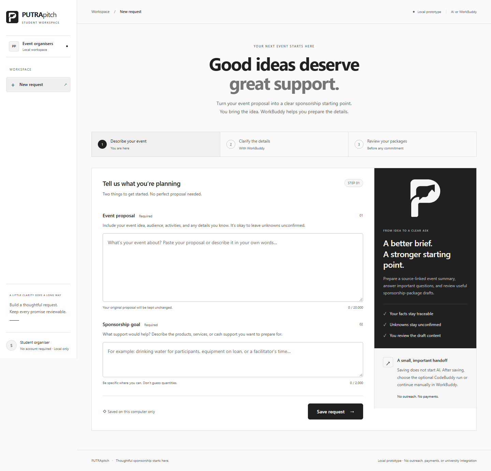
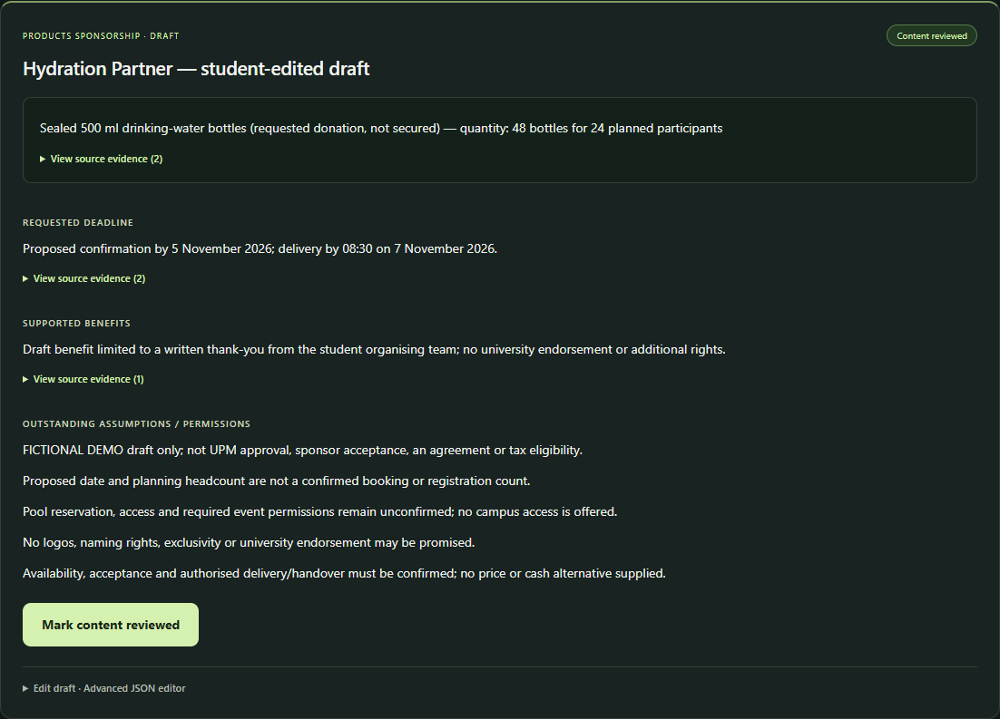
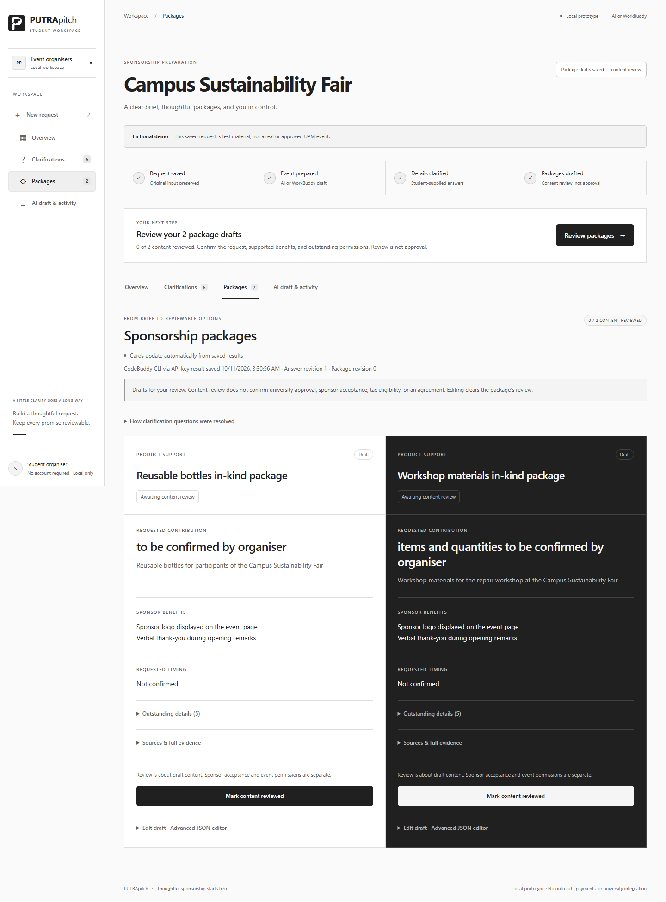

# PUTRApitch


PUTRApitch is the new project name. The existing repository URL, folder names, legacy environment variable (`SPONSORBRIDGE_PORT`) and historical evidence filenames remain unchanged for compatibility. The original P-and-pitch-arrow logo is a project identity, not an official university logo or endorsement.

**Helping UPM student organisers turn an event idea into a clear, reviewable sponsorship request.** Built with WorkBuddy; presented by Afiq.

Public source: https://github.com/ryuhanbin/sponsorbridge-hackathon

This repository contains a **local prototype**, not a hosted web application or an official UPM service. No sponsorship has been secured through the prototype and no businesses have been contacted.



## Problem and implemented features

The prototype is motivated by the need to clarify support quantities and timing, explain authorised sponsor benefits, and prepare useful packages. This is a problem framing, not a claim based on market statistics or user research.

Implemented:
- Save an original event proposal and sponsorship goal without overwriting them.
- Import selectable text from a PDF proposal into the event-proposal field for review before saving. The PDF file is processed locally and is not kept; scanned/image-only PDFs need OCR first.
- Have WorkBuddy read the saved request through a bounded local adapter, record a plan, extract source-linked facts, and ask clarification questions.
- Save student answers and, after an explicit WorkBuddy resume, persist updated event information and product/service package drafts.
- Edit package content through an advanced JSON editor and mark individual packages content-reviewed.
- Clear the affected package review after an edit; new answers make the continuation stale and invalidate current reviews.
- Optionally run the installed CodeBuddy CLI with a platform API key from the Activity view. One explicit run prepares the event or, after answers, drafts cards. The app checks the result against its source and package rules before saving it, and labels its author as CodeBuddy CLI.
- Responsive Overview, Clarifications, Packages, and Activity & handoff views, source evidence, and unsaved-change warnings.

**Content review is not university approval, sponsor acceptance, or an agreement.**

## Run locally

Require **Node.js 22.13 or newer**. Application files are **at the repository root**. Install the locked PDF.js dependency once before starting:

From the repository root:

```sh
npm ci
node server.mjs
```

Open **http://127.0.0.1:4317/**. Startup creates the local `data/` directory and its `.agent-key` if needed. Keep `data/` and all credentials out of commits; the generated local key must **never be committed or shared**. Run only one server against a given data directory. If port 4317 is occupied, stop your own known instance rather than starting a duplicate.

### View the pre-existing fictional demonstration

Use a fresh clone with no existing `data/` directory. Before starting the server, copy **only the JSON files** from `examples/fictional-swimming-clinic/`:

Git Bash / POSIX shell:

```sh
mkdir data
cp examples/fictional-swimming-clinic/*.json data/
node server.mjs
```

PowerShell:

```powershell
New-Item -ItemType Directory -Path data
Copy-Item -Path "examples/fictional-swimming-clinic/*.json" -Destination data
node server.mjs
```

Do not overwrite an existing local data directory. Do not copy keys, private records, or unrelated files into the example data. The server generates its own local key on startup.

Open:

http://127.0.0.1:4317/requests/req_65163d02-e331-4d92-aa41-10bde1d63f56

The included examples are **saved historical outputs from the WorkBuddy workflow**, not a new live agent run performed by copying them.

## Manual WorkBuddy handoff

For a new request or campaign starting point:
1. Save a proposal and goal in the browser.
2. Copy the request-specific instruction shown in Activity & handoff and start WorkBuddy manually in the repository workspace, with permission to use local tools.
3. WorkBuddy reads the current request through `adapter.mjs`, interprets the inputs, then saves a plan and preparation through validated operations.
4. Save answers in the browser. Explicitly resume WorkBuddy to reread the latest answers and save a continuation containing package drafts.
5. Review quantities, benefits, source passages, and outstanding conditions; edit and review the content before any proposed commitment.

Saving in the website **does not launch, wake, or resume WorkBuddy**. WorkBuddy performed actual interpretation and local read/write tool actions in the recorded demonstration, not merely code generation. Future runs require the user to start/resume it explicitly; organiser acceptance of this manual-handoff approach remains unresolved.

The adapter supports `read`, `ack`, `plan`, `preparation`, and `continuation`. Writes require a fresh read receipt bound to the request and answer revision. Receipts expire after 30 minutes and are invalid after a server restart; reread rather than reuse them. Do not write live workflow records directly.

## Optional CodeBuddy API key connection

The international CodeBuddy account provides a platform API key for CodeBuddy CLI. This route runs the CLI shipped with WorkBuddy as a **separate, tool-free model process**; it does not send a message to an existing WorkBuddy desktop conversation. The manual WorkBuddy route above remains available. The optional run may consume account credits, and key creation alone does not prove which credit pack it will use.

1. Open a saved request and choose **AI draft & activity → Draft sponsorship cards**.
2. On first use, the small setup dialog asks for the platform key. Choose **Save key and start draft**. The server saves it as `data/.codebuddy-key` on this computer, clears the field, and never returns the key to the browser. The file is plain text, so keep the local data folder private; the entire `data/` directory is ignored by Git.
3. On a new request, the first run prepares event details and questions. Review and answer them, then choose **Draft sponsorship cards** again. Each click starts at most one run; the page displays its actual status. When cards already exist, the button opens them without starting another run.
4. Review the source-linked output and cards. A model response that fails validation is rejected; it is not shown as a completed draft.

The local connection is restored after a server restart. **Disconnect key** removes the saved key. The CLI runs without file or command tools; the local server supplies the saved inputs and validates its streamed reply. It applies narrow formatting repairs to clarification questions, future checklist IDs/status, and unresolved answer sources, then rejects any unsupported facts or package promises. The CLI path defaults to WorkBuddy's Windows bundle and can be set with `CODEBUDDY_CLI_PATH` for another supported installation. This repository contains no API key.

The manual WorkBuddy handoff and saved activity remain available under **Advanced** on the same screen.

## Architecture

```text
Browser: public/index.html + public/styles.css + public/app.js
    | local HTTP requests and polling
Node service: server.mjs
    | validated workflow and package contracts
workflow.mjs + packages.mjs + store.mjs
    | immutable records and numbered revisions
Local data/ JSON files (outside public assets)

WorkBuddy -- manual tool execution --> adapter.mjs --> local Node service
Browser -- explicit AI run --> model-bridge.mjs --> CodeBuddy CLI model --> validated local records
```

The service uses Node built-ins, loopback-only HTTP, browser-session tokens, local-key adapter authorisation, and read receipts. Disk records preserve original input, answers, continuations, package edits, and content reviews. This is bounded local authorisation, **not cryptographic proof of WorkBuddy identity** or a production student account system. The conversation's actual tool actions establish the historical execution evidence.

## Fictional swimming-clinic example

**First Splash Swimming Clinic**, proposed by fictional Blue Lane, is not a real or approved UPM event. Its saved drafts request:
- **48 sealed 500 ml drinking-water bottles** for a planning assumption of 24 participants.
- **A loan of 12 kickboards**, with proposed same-day return.
- **One qualified swimming coach for three hours**; qualifications and safe supervision remain unchecked.

Only a **written thank-you from the student organising team** is offered. No logo rights, naming rights, exclusivity, campus access, university endorsement, cash amount, or tax eligibility is promised.

The proposed clinic is **7 November 2026, 09:00–12:00** at **Demo Training Pool**. The date is proposed, the headcount is an estimate, and pool reservation/access and event permissions remain unconfirmed. Contribution availability, acceptance, delivery/handover, equipment-loan responsibilities, and coaching safety arrangements also remain outstanding.



Screenshots capture the earlier demonstration; their displayed review counts are not a live status feed.

## Fictional CodeBuddy card example

The separate **Campus Sustainability Fair** test request produced two in-kind card drafts: reusable bottles and repair-workshop materials. Quantities, date, venue, approvals, and tax status remain unconfirmed. The only draft benefits come from an explicit fictional organiser answer: a logo on the event page and a verbal thank-you during opening remarks. The cards are awaiting content review.



## Small-business marketplace preview

Open `/marketplace` on the local server to see organiser-published sponsorship cards and two explicitly fictional sample listings. Each card is private by default. After reviewing its content, the organiser must acknowledge its visibility and explicitly publish it; they can remove it later. The public listing includes only a limited projection of the reviewed card, not the private proposal, goal, answers, activity, or evidence. A changed card or stale continuation disappears from the marketplace until reviewed and published again.

A small business can select an in-kind offer and interests. The fictional sample listings show fixed-rule fit reasons; published cards are passed through in their reviewed wording without an on-page AI score. **Copy WorkBuddy matching brief** prepares a manual WorkBuddy task to assess the published cards, or the fictional samples if none are published. A WorkBuddy result is produced only after that brief is run in WorkBuddy. No listing is an approved event, accepted offer, or sponsor commitment.

## Tests and evidence

Run the existing Node checks from the repository root:

```sh
npm test
```

- **11 October 2026:** all **29 Node checks** passed, including isolated fake-model preparation and card runs, stream parsing, source attribution, key persistence and removal, formatting repair, publication privacy/staleness checks, and PDF text import.
- **11 October 2026:** a live CodeBuddy CLI account call generated the fictional fair drafts. The first responses needed deterministic formatting repair and were recovered from local CLI traces, validated against the original proposal and answer, then saved. The updated one-click streamed path has automated tests but has not had a fresh live end-to-end run after this final repair.
- **10 October 2026:** earlier WorkBuddy reports recorded **63 Chrome UI checks**, including responsive widths and isolated in-memory mutation checks. These are historical results, **not freshly rerun browser checks**; mocked UI actions are not live WorkBuddy execution.
- **11 October 2026 UI rebrand:** the approved light/monochrome interface was renamed PUTRApitch across the local app and deck, with an original project logo. The reference-restyle check passed 134 browser assertions, followed by 138 rebrand browser assertions across eight widths (320–1440 px), including in-memory edit/review tests; 29 live data/key files were unchanged. These are UI checks, not another live sponsorship-model run.
- Current PUTRApitch screenshots and the legacy historical screenshots are in `evidence/`. `public/putrapitch-logo.svg` and `public/putrapitch-wordmark.svg` provide scalable logo assets. The six-slide local deck is delivered as `slides/PUTRApitch-pitch.pptx`; the legacy deck path is retained.
- `evidence/` contains the existing request, overview, and package screenshots. Browser verification tooling is separate from the runtime and is not needed to start the app.

## Current limitations and next steps

Working scope is **preparation, clarification answers, editable packages, content review, explicit publication of reviewed cards, and a local business-side preview with fixed-rule explanations for fictional examples**. A live WorkBuddy business-matching result, personalised sponsor pitches, and complete campaign export remain **planned**, not implemented.

The prototype is local, single-user and single-mutation-process. It is not multi-user production infrastructure. The optional website dispatch targets CodeBuddy CLI, not the WorkBuddy desktop conversation. There is no outreach, payment processing, hosted deployment, or live university integration. Exact source quotes support traceability but do not prove that an edited claim is semantically justified. Student review remains necessary. No student usability study, full screen-reader audit, or physical-device assurance is claimed.

No businesses were contacted, no funds were processed, and no university approval or sponsorship commitment was obtained.
