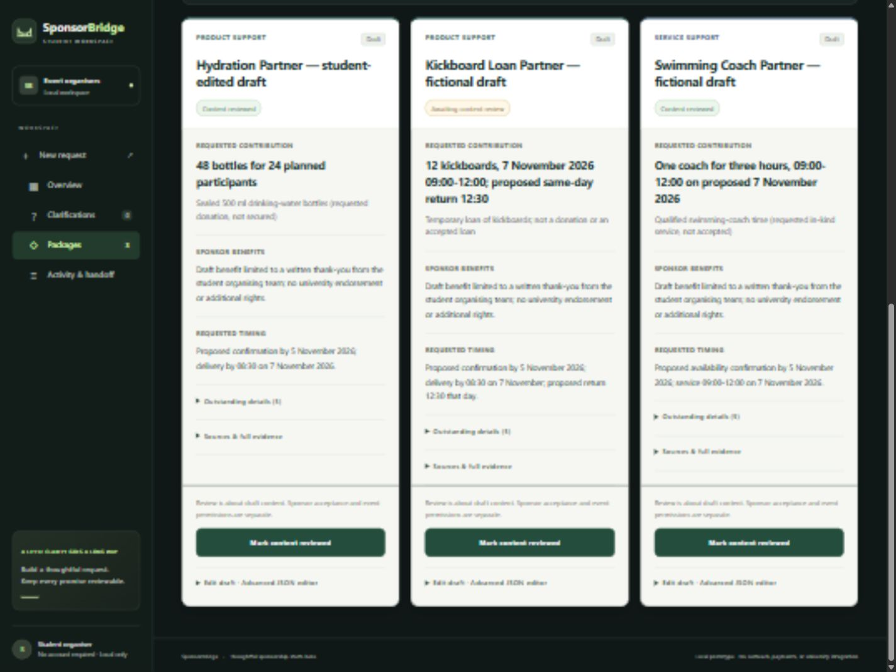
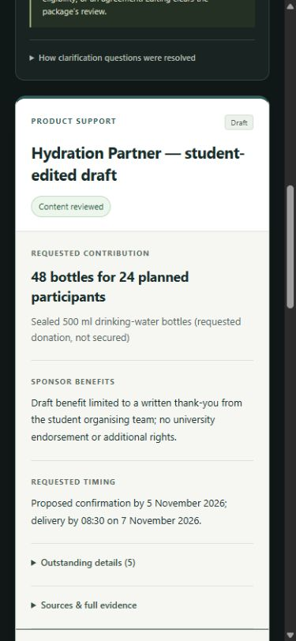

# Sponsorship card interface

Updated on 11 October 2026. WorkBuddy interprets the proposal and confirmed answers, then saves validated package drafts through the existing adapter. The browser checks saved state every two seconds and renders those drafts as responsive comparison cards. Displaying cards does not call a model or use WorkBuddy credits. Starting or resuming WorkBuddy is still manual.

Each card shows the saved title, contribution type, exact requested quantity or cash amount, supported benefits, requested timing, and content-review status. Outstanding details and full source quotations remain available in disclosures. Unknown values stay unconfirmed. A source reference establishes traceability, not truth or approval. Package titles can be supplied as Platinum, Gold, or Silver; this interface does not invent tier prices or benefits.

The supplied demonstration is fictional. Its cards request 48 water bottles, a loan of 12 kickboards, and one coach for three hours. Sponsor acceptance, event permissions, and safe supervision remain unconfirmed. Only a student-team written thank-you is authorised.

## Verification

The 22 existing Node checks passed on the isolated submission copy on 11 October 2026. Browser checks used a separate fixture directory and server, leaving the original saved request unchanged:

- Before saved package results arrived: waiting message, zero cards. After the existing fictional results became available: three cards appeared through polling without reloading. This checks display updates, not a new AI execution.
- Desktop at 1440 × 1080: three columns. Phone at 390 × 844: one column with no horizontal overflow.
- Source disclosures retained exact quotations; a source link opened the corresponding clarification answer.
- An unsaved package edit survived polling. Saving the edit updated its card and cleared its review; reviewing it again displayed “Content reviewed”.
- After applying the interface files to the original running app, it still showed the original three cards and two content reviews. The source link focused the correct answer and retained the Clarifications tab on reload.

The WorkBuddy-created six-slide presentation in `slides/SponsorBridge-pitch.pptx` and its README were copied unchanged. The deck contains historical interface screenshots; these images show the newer card layout.
